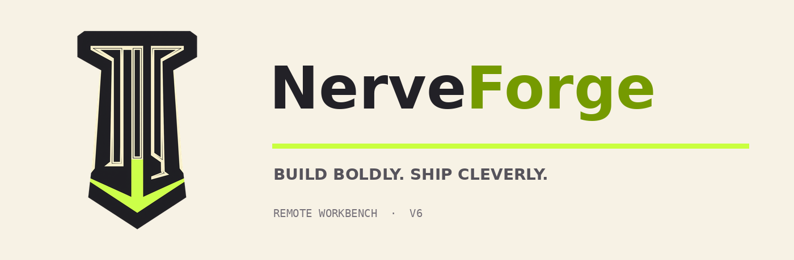

# NerveForge 7.0.2 ⚡ Arena.ai ↔ PC Bridge



**NerveForge** — это быстрый, асинхронный и легковесный мост (bridge) между ИИ-агентами платформы **Arena.ai** (в режиме Agent Mode) и локальным физическим ПК разработчика (Linux Mint / Ubuntu / Windows 11).

Он позволяет агенту из веб-интерфейса Arena.ai напрямую взаимодействовать с твоим компьютером: выполнять команды в терминале (Bash / PowerShell / CMD), читать и редактировать файлы, компилировать проекты, писать код и загружать скрипты/шейдеры прямо в открытый проект Unity и не только!.

```
+--------------------------------------------------------------------------------------------------+
|                                      АРХИТЕКТУРА МОСТА                                           |
+---------------------+             +--------------------+             +---------------------------+
|      Arena.ai       |  (HTTPS)    | Туннель Cloudflare |  (Loopback) |  Локальный ПК (NerveForge)|
|    (Agent Mode)     | <=========> |     / Tailscale    | <=========> |  • Terminal (Bash/Pwsh)   |
| Облачный контейнер  |             |  Авто-публикация   |             |  • Unity Assets (C#/Shader|
|      с агентом      |             |     URL-адреса     |             |  • Файловая система / IDE |
+---------------------+             +--------------------+             +---------------------------+
```

> ⚠️ **Предупреждение о безопасности:** Режим полного доступа (`full-access`) открывает прямой доступ к терминалу хоста без песочницы для агента с Bearer-токеном. Рекомендуется запускать на выделенном тестовом ПК или в изолированной среде.

---

## ⚡ Главные возможности NerveForge

- **Прямая интеграция с Arena.ai:** агент получает публичный HTTPS-эндпоинт и Bearer-токен и может автономно писать код, тестировать сборку, парсить `Editor.log` и исправлять ошибки компиляции.
- **Асинхронный высокопроизводительный движок:** пул воркеров (`concurrent.futures.ThreadPoolExecutor`), сокеты `TCP_NODELAY`, буферизованный I/O и субмиллисекундный отклик.
- **Тихий запуск и чистый терминал:** автоматическое создание Cloudflare Quick Tunnel без лишнего лог-спама в консоли.
- **Динамическое переключение туннелей в веб-панели:** мгновенный выбор между `⚡ Cloudflare Quick Tunnel`, `🔒 Tailscale Funnel` и `🏠 Только локально` прямо из браузера.
- **Управление Unity-проектами:** открытые эндпоинты `/api/public/scripts` и `/api/public/assets` для мгновенной заливки `.cs` и `.shader` в рабочую папку `Assets`.
- **Масштабируемые лимиты:** поддержка передачи команд до **40 МБ**, вывода до **50 МБ** и тел запросов до **64 МБ** с API динамической регулировки (`GET/POST /api/limits`).
- **Полный доступ без ограничений:** кодовая фраза `yesiknow`, отсутствие искусственного троттлинга запросов и блокировок параллельного запуска.
- **Zero-Dependency:** чистый Python 3.10+ (только стандартная библиотека, никаких сторонних `pip`-пакетов).

---

## 🚀 Быстрый старт: Как подключить Arena.ai к ПК

1. **Запустите NerveForge на компьютере:**
   * **Linux Mint / Ubuntu:**
     ```bash
     bash setup.sh
     ```
   * **Windows 11 (в PowerShell):**
     ```powershell
     Set-ExecutionPolicy -Scope Process Bypass
     .\setup_windows.ps1
     ```
   * **Универсальный запуск через Python:**
     ```bash
     python3 run.py
     ```

2. **Скопируйте данные подключения из терминала:**
   При старте NerveForge выведет компактный блок:
   ```text
   ================================================================
     NERVEFORGE ГОТОВ К РАБОТЕ
     Публичный адрес:  https://xxxx-xxxx-xxxx.trycloudflare.com
     Локальная панель: http://127.0.0.1:8766/
     Токен:            25kbVfTtJKiUxy93_8A4gfcUSdB5QcEFtKvXIJt2_B1...
   ================================================================
   ```

3. **Отправьте адрес и токен агенту в Arena.ai:**
   * Просто отправьте ссылку и токен в чат с агентом на Arena.ai.
   * Агент подключится к вашему ПК через туннель и сможет выполнять задачи!

---

## 🔑 Режим полного доступа (Full Access)

Активируется в верхней карточке веб-панели (`http://127.0.0.1:8766/`) или через API:

1. Введите кодовую фразу: **`yesiknow`**
2. Выберите длительность сеанса (от 1 до 1440 минут).
3. Нажмите **ВКЛЮЧИТЬ** — мост перейдёт в режим прямого выполнения команд.
4. Агент Arena.ai сможет запускать команды (`bash`, `powershell`, `cmd`), переходить в любые директории (`cwd`) и работать параллельно.
5. Кнопка **«Немедленно выключить»** или `POST /api/full-access/stop` мгновенно останавливает все дочерние деревья процессов.

---

## 🌐 Веб-панель управления

- **Терминал:** локальный веб-терминал с выбором оболочки и быстрыми командами под ОС.
- **Туннели:** переключение на лету между Cloudflare Quick Tunnel, Tailscale Funnel и локальным режимом.
- **Файлы:** просмотр файлов проекта, встроенный текстовый редактор с созданием бэкапов.
- **Очередь:** просмотр и подтверждение системных действий и правок конфигураций.
- **Журнал:** кольцевой журнал HTTP-запросов и аудит действий агента.
- **Тема:** тёмная/светлая тема с автосохранением в браузере.

---

## 📡 Спецификация API

Все защищённые вызовы требуют заголовок: `Authorization: Bearer <token>`.

### Управление терминалом и доступом

| Метод / Эндпоинт | Тело запроса | Описание |
| :--- | :--- | :--- |
| `POST /api/full-access/config` | `{"armed": true, "duration_seconds": 7200, "confirmation": "yesiknow"}` | Включение/настройка полного доступа |
| `POST /api/full-access/stop` | `{}` | Экстренное отключение и остановка процессов |
| `POST /api/full-access/run` | `{"command": "...", "timeout_seconds": 120, "shell": "bash", "cwd": "/path"}` | Асинхронный запуск команды |
| `GET /api/full-access/jobs/<id>` | — | Получение статуса и вывода команды |
| `GET /api/quick` | — | Сводка платформы, туннеля и статуса доступа |
| `GET /api/limits` | — | Текущие лимиты команд (40 МБ), вывода (50 МБ) и тела (64 МБ) |
| `POST /api/limits` | `{"max_command_mb": 40, "max_output_mb": 50}` | Динамическая регулировка лимитов |
| `POST /api/tunnel/config` | `{"mode": "tailscale"}` | Переключение туннеля (`cloudflared`, `tailscale`, `none`) |

### Файловая система и рабочая область

| Метод / Эндпоинт | Тело запроса | Описание |
| :--- | :--- | :--- |
| `POST /api/workspace/list` | `{"path": "."}` | Список файлов и папок |
| `POST /api/workspace/read` | `{"path": "file.txt"}` | Чтение файла |
| `POST /api/workspace/write` | `{"path": "file.txt", "content": "..."}` | Запись файла с созданием бэкапа |
| `POST /api/workspace/run` | `{"command": "...", "timeout_seconds": 60}` | Запуск команды в песочнице workspace |

### Анонимный импорт в Unity (без токена)

| Метод / Эндпоинт | Описание |
| :--- | :--- |
| `POST /api/public/scripts` | Создание нового C#-скрипта (`.cs`) в корне рабочей папки |
| `POST /api/public/assets` | Создание шейдера (`.shader`) или скрипта (`.cs`) |

---

## 🧪 Тестирование и качество кода

```bash
# Запуск 62 unit-тестов
python3 -m unittest discover -s tests -v

# Проверка байткода Python
python3 -m compileall -q src tests run.py

# Проверка синтаксиса JavaScript
node --check static/app.js

# Проверка bash-установщика
bash -n setup.sh
```

---

## 📂 Структура репозитория

```text
nerveforge/
├── .github/workflows/tests.yml   # GitHub Actions CI (Ubuntu + Windows)
├── assets/                       # Логотипы и брендинг
├── docs/                         # Архитектурная документация
├── scripts/                      # Скрипты инсталляции системных хелперов и ярлыков
├── src/nerveforge/               # Исходный код Python-пакета
│   ├── bridge.py                 # HTTP-сервер, роутинг, асинхронный воркер-пул
│   ├── config_manager.py         # Мониторинг конфигураций systemd/autostart
│   ├── paths.py                  # Разрешение путей данных и конфигураций
│   ├── platform_support.py       # Детектирование ОС, шеллов и окружения
│   ├── tunnel.py                 # Управление туннелями Cloudflare и Tailscale
│   ├── uzhas_manager.py          # Shell-раннер полного доступа и остановка процессов
│   └── workspace_manager.py      # Файловые операции и песочница
├── static/                       # Ассеты веб-панели (HTML, CSS, JS)
├── tests/                        # Набор unit-тестов (62 теста)
├── pyproject.toml                # Стандарт сборки PEP 517/518
├── run.py                        # Точка входа для запуска на месте
├── setup.sh                      # Установщик для Linux Mint / Ubuntu
├── setup_windows.ps1             # Установщик для Windows 11
├── LICENSE                       # Лицензия MIT
├── SECURITY.md                   # Политика безопасности
└── README.md                     # Главная документация моста
```

---

## 📄 Лицензия

Проект распространяется под свободной лицензией [MIT](LICENSE).
